  
  

**Data Science & AI student at PUC-SP · Back-end developer intern**

I build machine learning pipelines and the back-end systems that take them to production. Open to remote work in back-end, machine learning and AI.

**Highlights**

- **BacResist_IA**: ML pipeline for genomic surveillance of bacterial resistance, validated on more than 8,000 bacterial genomes. Python, XGBoost, FastAPI, MLflow.
- **[Chat Zap](https://github.com/Luizz963/zap-service)**: WhatsApp desktop app with an assistant that understands commands in plain Portuguese. TypeScript, React, Node.js.
- **Back-end internship**: Java microservices with Spring Boot, Docker and Kafka, in production since August 2025.

The full interactive version, where the pixel cover reacts to your clicks, is at <a href="https://luizz963.github.io">luizz963.github.io</a>.
